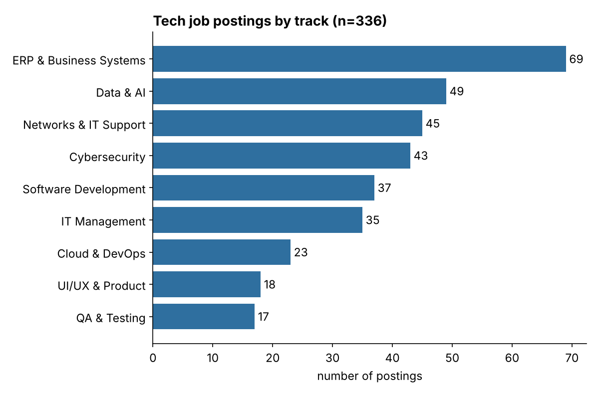
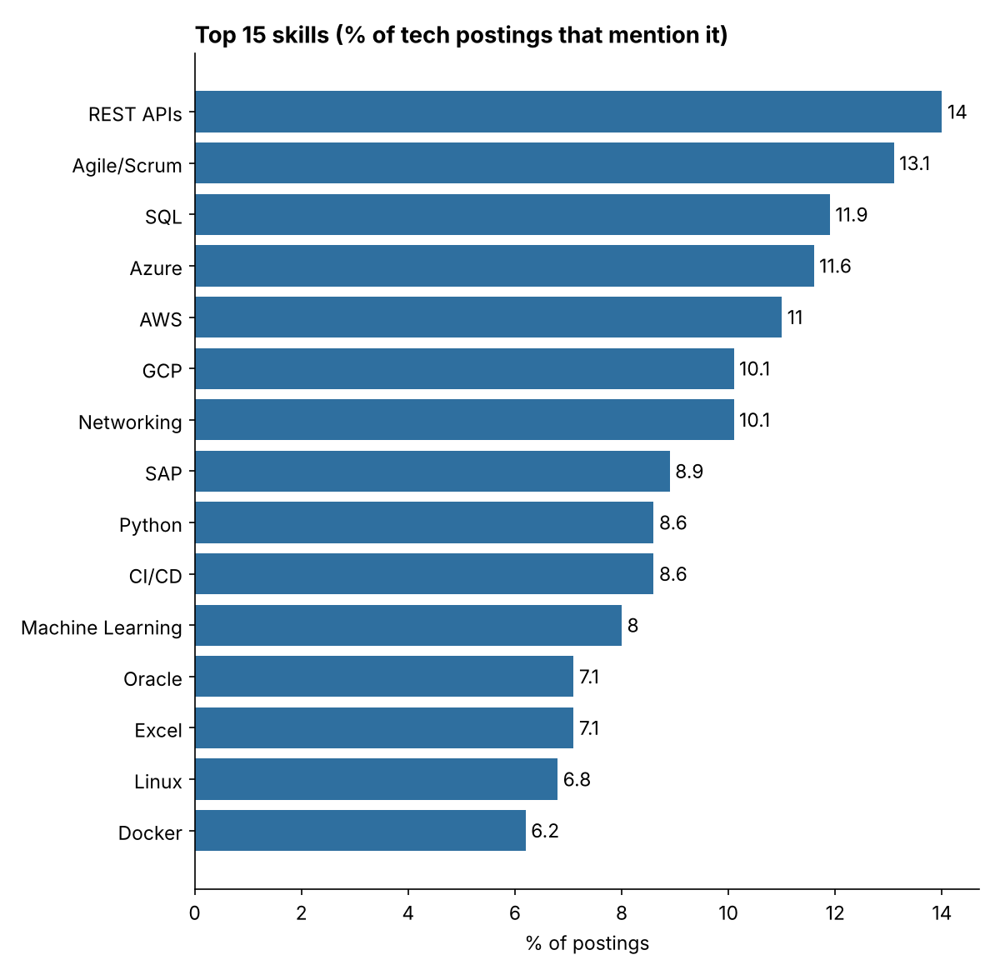
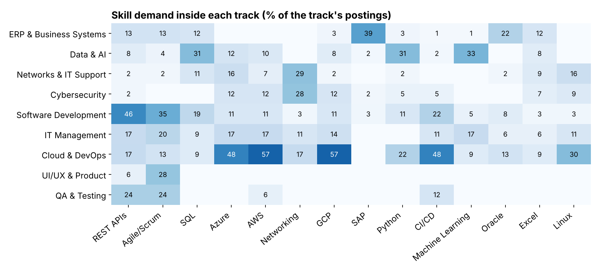
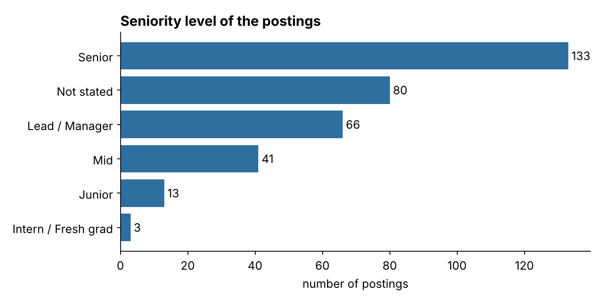
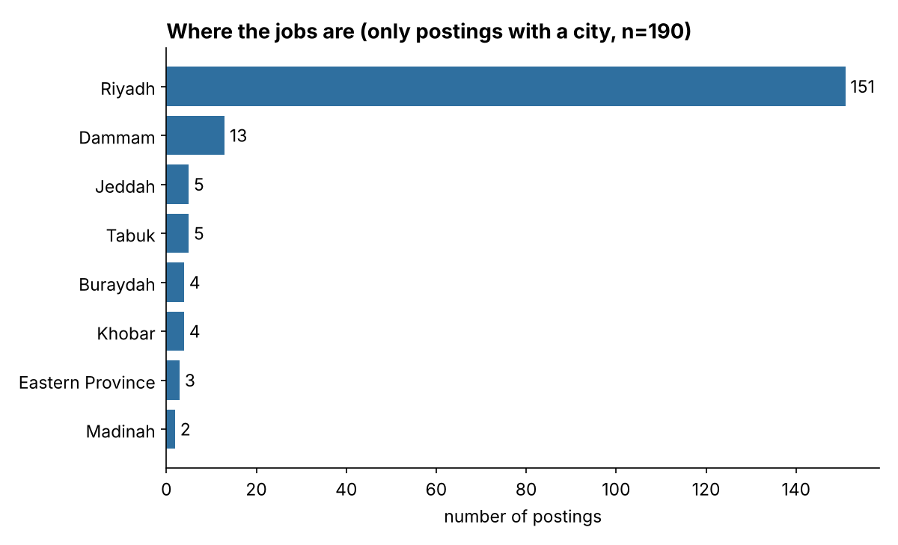

# Saudi Tech Job Market Analysis

I'm graduating in Computer Science soon and I couldn't decide which track to focus on
(frontend, data, cybersecurity...). Instead of guessing, I took real job postings from
Saudi Arabia and checked what companies actually ask for.

**Questions**

1. Which tech track has the most openings?
2. Which skills are asked for the most, overall and inside each track?
3. How many years of experience do they want, and how much is open to juniors?
4. Where are the jobs?

## Data

- 5,505 job postings from Bayt.com for Saudi Arabia, posted between Nov 2024 and Apr 2025.
- The listings were collected by the [DataMentes team](https://github.com/DataMentes/Job-Market-Insights-analysis).
  I did not scrape them myself, so the raw file is **not** in this repo. `src/get_data.py` downloads it.
- After removing duplicates and keeping only tech titles I ended up with **336 tech postings**.

## What I found

**1. Tracks**



ERP / business systems (SAP, Oracle, business analysts) is the biggest group with 69 postings.
Data & AI (49), networks & IT support (45) and cybersecurity (43) are close to each other.
Pure software development is only 37.

**2. Skills**





- No single skill dominates. The top ones (APIs, Agile, SQL, cloud platforms) each show up in 10–14% of postings.
- Skills depend a lot on the track, so the heatmap is more useful than the overall chart:
  - **Data & AI:** SQL and Python (31% each), machine learning (33%), ETL / pipelines (39%), Power BI (27%)
  - **Software development:** REST APIs (46%), JavaScript (32%), Java (30%)
  - **Cybersecurity:** ISO 27001 / NCA frameworks (35%), security certificates (33%), networking (28%)
  - **Cloud & DevOps:** AWS and GCP (57% each), Azure, Kubernetes and CI/CD (48% each)
- REST APIs and Agile/Scrum are the only skills that show up in almost every track.

**3. Experience**



This was the part I didn't like. Out of 192 postings that state the years of experience,
the median is **5 years** and only **13.5%** accept 2 years or less.
By title, only 16 of 336 postings are junior / intern / fresh grad.
Networks & IT support (25%), software development (24%) and cybersecurity (22%) have the highest
share of postings asking for 2 years or less. Data & AI has the lowest (4%, median 7 years).

**4. Cities**



Only 190 postings mention the city. From those, 151 (79%) are in Riyadh, then Dammam (13).

## Limits

- 336 postings from one website and about five months. It's a sample, not the whole market.
  Some tracks are small (QA has 17 postings), so their percentages can move a lot.
- I pick tech jobs and skills with keyword lists (`src/config.py`). I checked the titles by hand
  and fixed wrong matches (for example "QA/QC inspector" in construction), but some mistakes surely remain.
- A skill is counted if it is mentioned anywhere in the posting, even as "nice to have".
  About a quarter of the postings have short descriptions with no skills at all, so the real percentages are probably higher.
- Bayt has few fresh-grad programs (Tamheer, co-op, company graduate programs), so junior demand is likely under-counted.

## How to run

```
pip install -r requirements.txt
python src/get_data.py     # downloads the raw csv
python src/clean.py        # filters tech jobs, adds track / skills / level
python src/analyze.py      # makes the charts and the tables in results/
```

## Files

```
src/config.py     keyword lists (tracks, skills, cities)
src/get_data.py   download the raw data
src/clean.py      cleaning and labeling
src/analyze.py    charts and result tables
results/          small csv tables with the numbers behind the charts
figures/          the charts
```

## Next

- Add newer postings and compare with this period.
- Add Jadarat open data to cover government and fresh-grad jobs better.
